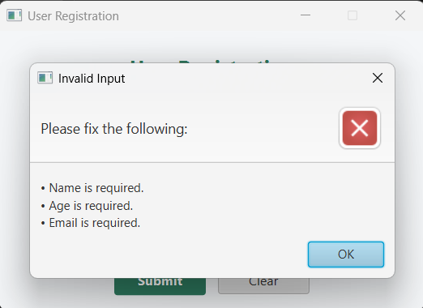
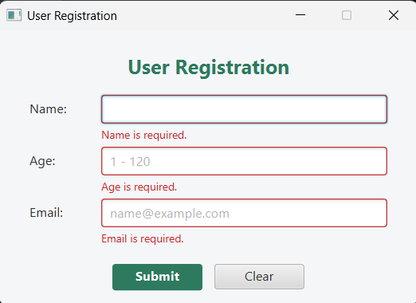
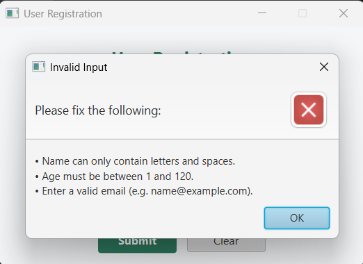
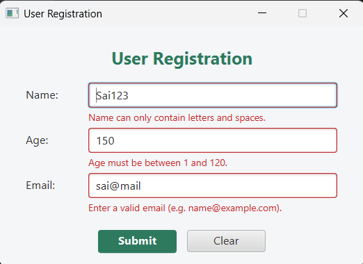
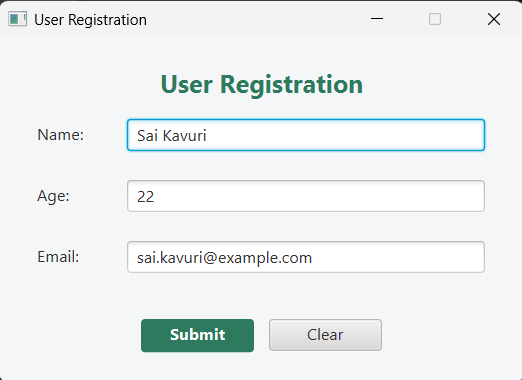
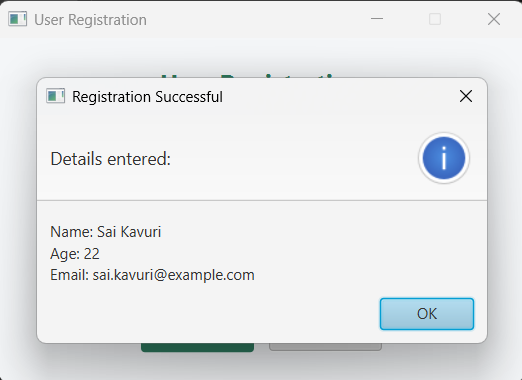

# Lab 5 – JavaFX User Registration (MVC)

**Course:** CSYE 6200 – Concepts of Object-Oriented Design  
**Student:** Sai Vardhan Simha Kavuri  
**University:** Northeastern University, Toronto

A simple JavaFX application that collects a user's **Name, Age and Email**, validates the input, and shows the entered details in a pop-up on **Submit**. The UI is defined in FXML (editable in Scene Builder) and the project follows the **Model–View–Controller (MVC)** architecture.

## MVC Structure

```
Lab_5/
├── src/
│   ├── main/
│   │   └── Main.java                    # Entry point – loads the FXML view into the Stage/Scene
│   ├── model/
│   │   └── User.java                    # Model – name, age, email
│   ├── view/
│   │   ├── UserForm.fxml                # View – layout built for Scene Builder
│   │   └── style.css                    # View styling
│   └── controller/
│       └── UserFormController.java      # Controller – validation, events, pop-ups
├── screenshots/                         # Screenshots of the running application
├── nbproject/
├── build.xml
└── manifest.mf
```

## Features

- Name, Age and Email fields with **Submit** and **Clear** buttons
- On Submit, a pop-up (`Alert`) displays the entered details
- Errors are shown both inline (red text and red border under the field) and in an error pop-up
- Errors clear automatically as soon as the field is edited

## Validations

| Field | Rule |
|---|---|
| Name | Required; letters and spaces only; 2–50 characters |
| Age | Required; digits only (non-digits cannot be typed); 1–120 |
| Email | Required; valid format (`name@example.com`) |

## Setup

- **JDK:** 26 (works with JDK 23+)
- **JavaFX SDK:** 25.0.2 – extracted to `C:\javafx-sdk-25.0.2`
- **Scene Builder:** 25.0.0
- **NetBeans:** a global library named `JavaFX` (Tools → Libraries) containing the jars from `C:\javafx-sdk-25.0.2\lib`, added to the project's compile classpath
- **VM options** (Project Properties → Run):

```
--enable-native-access=javafx.graphics --module-path "C:/javafx-sdk-25.0.2/lib" --add-modules javafx.controls,javafx.fxml
```

## How to Run

1. Open the `Lab_5` folder in Apache NetBeans (**File → Open Project**).
2. Press **F6** (or right-click the project → **Run**).
3. To edit the UI, right-click `view/UserForm.fxml` → **Open** (opens in Scene Builder).

## Screenshots

| Registration form | Empty fields – pop-up |
|---|---|
|  |  |

| Empty fields – inline errors | Invalid input – pop-up |
|---|---|
|  |  |

| Invalid input – inline errors | Form filled |
|---|---|
|  |  |

| Success pop-up |
|---|
|  |
